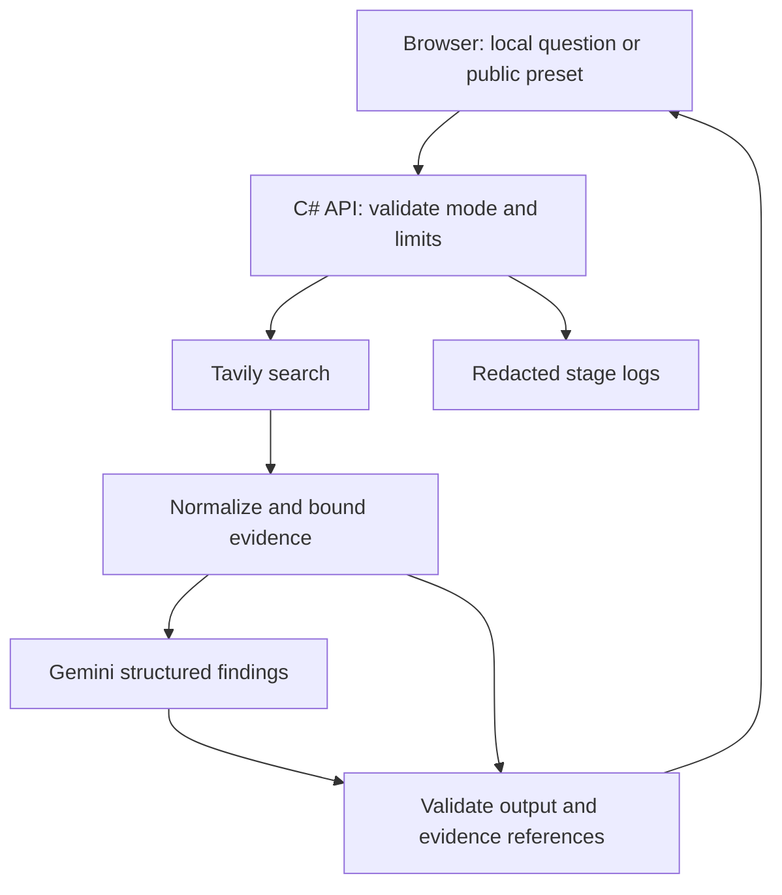

# Supplier Research Assistant — updated MVP

Version 2 | October 17, 2026 (Vancouver)
Status: updated specification for review. Implementation has not started.
This replaces the earlier two-environment/promotion specification.

## 1. Purpose and authority

Help an analyst review publicly reported supplier sustainability practices and identify useful follow-up questions. The learning goals are C#, external API integration, failure handling, tests, Docker and Azure deployment.

The system reports source claims. It does not independently establish sustainability performance, verify certifications, approve suppliers or certify compliance. A finding should attribute a narrow statement, not label a supplier environmentally responsible. Missing search evidence does not prove a practice is absent.

Confirmed setup: Windows/PowerShell, local VS Code terminal with Codex; no project folder/Git repository yet; Azure signup completed; Docker Desktop downloaded; no Gemini key at last confirmation. Azure credits/permissions, running Docker, .NET installation and Tavily credentials are unverified. Hosted interviewer access and eventual public availability are desired; repository/image visibility remains a separate decision.

## 2. MVP scope

Included:
- One C# application serving a basic HTML/JavaScript interface and API.
- Real public search first, then one structured-generation call.
- Up to five sources, attributed findings with supporting text spans, and useful follow-up questions.
- Explicit no-evidence, sources-only, error, live and saved-example states.
- One container, one Azure application, one GitHub build/test workflow.
- Focused automated tests, five behavioral cases, separate live checks and a short demo.

Deferred: database, chat history, uploads, vector search, crawlers, PDF extraction, autonomous agents, MCP, React, Python sidecar, microservices, custom login, Bicep, staging environment, automatic deployment/promotion/rollback, automated semantic grading and extensive benchmarks.

Record the deployed commit and image digest. Environment promotion is a later extension; this MVP does not establish implementation experience in promotion pipelines.

## 3. Architecture



These are internal modules, not separate services. Two provider interfaces enable deterministic test doubles. No persistent application database. Reviewed saved examples are static files.

Stack: .NET 10 LTS/ASP.NET Core Minimal APIs, native HttpClient and System.Text.Json, plain HTML/CSS/JavaScript, xUnit and ASP.NET integration tests, Docker Linux image, GitHub Actions, GHCR, Azure Container Apps Consumption. Pin supported SDK/package versions and a working free-tier-compatible model during preflight. Do not infer API entitlement from a consumer chat subscription.

Proposed repository:

```text
src/SupplierResearch/
  Program.cs
  Contracts/
  ResearchService.cs
  Providers/        # two interfaces and two real adapters
  Validation/
  Prompts/
  wwwroot/
tests/SupplierResearch.Tests/
  Fixtures/
evals/cases.json
evals/results.md
docs/architecture.md
docs/runbook.md
.github/workflows/ci.yml
Dockerfile
.dockerignore
.gitignore
global.json
README.md
```

## 4. Evidence contract

Use Tavily basic search result content, titles and URLs; disable provider-generated answers, raw-content/crawl features and automatic parameter escalation. Inspect actual returned fields in preflight.

The application does not fetch linked pages. Label every input source `provider_excerpt`: text returned by the search provider, not an independently verified full page. Do not imply it is a verbatim quotation from the original website. Show that provenance in the UI.

Bound evidence to five unique HTTP(S) URLs, 2,000 characters per excerpt and 10,000 characters total. Filter unusable results, deduplicate conservatively, and assign request-scoped source IDs. Preserve publication date only if provided and usable; retrieval time is separate. Never claim a report is the latest just because it was retrieved now.

Model returns 1–5 narrowly attributed findings when supported. Each finding contains evidence references with a source ID and exact span from the supplied provider excerpt. The server checks ID existence, span membership, schema and length. This proves traceability, not semantic support or original-page authenticity.

Example attribution: “The provider excerpt for the supplier report states a packaging-waste reduction target.” Naming a specific year/report requires evidence for that detail.

Follow-up questions are separately labeled suggestions, usually 1–3 when useful. They must not embed unsupported assertions. Example: “What baseline and reporting period apply to this target?” No invented citations. If no useful questions exist, omit them.

Conflicting excerpts remain separately attributed; do not fabricate a resolution. Test conflict behavior on fixed evidence, without claiming complete automatic conflict detection. Invalid model JSON/references produce sources-only output, without a second generation call to repair it.

## 5. Interfaces and behavior

Local: `POST /api/research`, body `{supplier, question}`. Arbitrary questions only when explicitly enabled locally; bind local service to loopback. In hosted mode this route is NOT mapped, rather than merely hidden in the UI.

Public live: `POST /api/demo/{presetId}`. Server resolves supplier/question from an allowlist. Reject unknown IDs and input overrides before provider calls. No client-selected model or search options.

Saved: `GET /api/examples/{presetId}`. Response includes capture date and visible `saved_example` mode. Never silently substitute saved output for live results.

Supporting routes: `GET /health` without provider calls; `GET /api/version` with public commit/build metadata and no secrets.

Representative response shape (illustrative, not real research):

```json
{
  "requestId":"opaque-id",
  "mode":"live",
  "status":"complete",
  "retrievedAt":"2026-10-18T02:00:00Z",
  "findings":[{
    "text":"The provider excerpt reports a packaging target.",
    "evidence":[{"sourceId":"s1","excerptSpan":"packaging target"}]
  }],
  "followUpQuestions":["What baseline applies to this target?"],
  "sources":[{
    "id":"s1","title":"Example source","url":"https://example.com/report",
    "evidenceType":"provider_excerpt",
    "excerpt":"Example packaging target text.","publishedAt":null
  }],
  "warnings":[]
}
```

| Situation | Behavior |
|---|---|
| Evidence + valid generation | `complete`: supported, attributed findings |
| No sufficient evidence/model abstains | `insufficient_evidence`: no invented answer; retain usable sources |
| Generation unavailable, timed out or invalid | `sources_only`: evidence retained, warning explicit |
| Search failure | Error; no synthesized current answer |
| Invalid input | 400; zero provider calls |
| Local limit reached | 429; zero provider calls |
| Public arbitrary route/unknown preset | 404; no provider calls |
| Public live disabled | Explicit unavailable state; separately offer saved examples |

Fatal failures use safe Problem Details with request ID: 502 invalid upstream/search failure, 503 unavailable/quota/configuration, 504 search deadline. Provider authentication failure is a service configuration problem, not an end-user password error.

## 6. Public interaction and cost boundary

Proposed product trade-off requiring explicit approval before hosted deployment: arbitrary queries locally; server-defined live presets publicly, only after controls pass; otherwise public saved examples and local live demonstration. This does not promise arbitrary public querying.

Controls:
- One active cloud revision, maximum one replica; one in-flight live request, no queue.
- Application-wide three live submissions/minute and twenty admitted live requests per process lifetime. Use atomic admission controls; all provider calls pass through them.
- Hosted live switch defaults off; blocks both search and generation. Test alternate-route and preset-override attempts.
- Counters reset after restart and overlapping processes can multiply limits. They are NOT durable daily/global spending caps.
- Verify free-only provider plans stop at quota and paid fallback is disabled. If provider cost boundaries cannot be established, hosted live calls remain off.
- Review actual Azure credit/billing protection and logs; budget notifications are not a hard spending cap. Target $0 out of pocket is conditional, not guaranteed permanently free hosting.

Presets alone cannot prevent quota exhaustion. No custom authentication infrastructure is required for this constrained demo. Saved examples must remain transparently labeled if live mode is disabled or quota is exhausted.

## 7. Reliability, privacy and configuration

Input limits: supplier 2–120 characters, question 10–500, request 8 KiB. Output: five findings maximum, 600 characters each, evidence spans 300 characters maximum, follow-up questions 200 characters each.

Total app deadline 30 seconds; search up to 8 seconds and generation up to 15 within remaining time; browser deadline 35 seconds. Pass cancellation downstream; cancellation does not guarantee the provider has not already billed/consumed quota. No automatic retries on billable provider requests. Explicit user retry is a new request.

Keys stay server-side through local User Secrets/environment and Azure Container Apps secrets. No secrets in Git, image layers, browser code or logs. Public research only, with a short provider-transmission notice. Never use employer documents.

External text is untrusted data. Model cannot invoke tools, perform writes, change permissions or select providers. Grounding instructions reduce risk but do not guarantee injection resistance. Render text safely without raw HTML; validate link schemes; do not fetch arbitrary URLs server-side. Same-origin UI/API, no permissive CORS.

Log request ID, stage, duration, mode, outcome, source count, commit/prompt/model identifier, and usage only when actually returned. Do not log questions, evidence bodies, keys or auth headers by default. No application history is persisted.

Pin prompt/model/settings and record them in evaluation notes. Validate live configuration at startup; no silent fallback to another model. Fixture mode works without keys and is clearly labeled. Cloud mode must not inherit local arbitrary-query defaults.

## 8. Testing and acceptance

Automated tests mock both providers and run without credentials. Live tests are separate and opt-in, not automatic PR checks. One test project and a short manual browser checklist are sufficient initially.

Five fixed behavioral cases:
1. One clear supported claim.
2. Multiple supported claims needing a useful summary.
3. Supported claim with missing context, producing a useful follow-up question.
4. Insufficient evidence: abstention.
5. Conflicting excerpts: separate attribution and uncertainty.

Each positive case must produce at least one supported finding; always-abstain is not a pass. Manually inspect every substantive finding against the supplied excerpt. For positive live examples, inspect at least one original linked page each and record whether it matches the provider excerpt. This spot-check does not verify every source.

Failure tests: empty/malformed provider response, search/generation timeout, auth/rate/quota failure, unsafe or duplicate URLs, unknown citation IDs, invented excerpt spans, prompt injection, unsafe rendered text, concurrent admission, hosted arbitrary-route rejection, preset overrides and disabled-live mode.

Run a small separate live set; date results and record model/prompt, observed latency, sources and limitations. Compare the usefulness of sources-only versus findings/follow-ups. No production-accuracy claim or formal p95 gate.

Definition of done:
- Clean checkout builds/tests; fixture mode runs without keys.
- Browser -> C# -> actual search -> structured findings works locally.
- Five behavior cases and failure checks pass; reviewed findings supported and properly attributed.
- Source-only/no-evidence/error/live/saved modes are distinct.
- No secrets/employer materials committed; hosted presets and limits enforced server-side.
- Docker image runs and Azure endpoint responds; commit/digest recorded.
- README/runbook covers setup, test commands, secrets by name, manual deployment, limits, disable-live and resource cleanup.
- Felicia can trace the code, modify a behavior and reproduce/debug one failure.

If Azure's early feasibility check fails beyond its timebox, preserve the local app and document the blocker. Call it a local MVP with cloud deployment pending, not completion of the Azure target.

## 9. Milestones and learning

Codex must inspect the actual chosen local folder, applicable AGENTS.md, files, Git status/remotes and installed tools before changes. Establish GitHub remote before application implementation; do not silently proceed local-only if authentication fails. Choose remote owner/name and repository/image visibility explicitly. Exclude resumes and interview materials.

| Milestone | Hours | Checkpoint | Commit example |
|---|---:|---|---|
| M0 Preflight and remote | 2 | .NET runs, Docker Linux container works, GitHub connected, provider call each, basic Azure container responds; record quotas/credit/model | `Add project scope and setup notes` |
| M1 Search vertical slice | 3 | Browser -> C# -> real Tavily -> bounded sources; mocked search tests | `Add supplier search and source results` |
| M2 Structured findings | 3 | Generation, evidence spans, attribution and follow-ups; provider test doubles | `Add source-backed findings` |
| M3 Failures and public controls | 4 | Deadlines, fallbacks, limits, presets, saved examples; failure checks and five-case review | `Handle failures and constrain public requests` |
| M4 Container, CI, deployment | 4 | Container app, one build/test workflow, manual single Azure deployment; inspect logs/version/limits | `Containerize and deploy the app` |
| M5 Verify and explain | 2 | Clean-checkout check, live evaluation, docs and short demo | `Document verification and demo steps` |

18 project hours + 6 interview preparation + 8 rest + 4 contingency = 36 elapsed hours. M0 is a feasibility timebox, not a guarantee missing accounts/tooling can be configured in two hours.

After each milestone: run relevant checks, inspect the diff, commit verified work and push. If a check fails: capture the actual error, isolate the boundary, test one hypothesis, fix the root cause. No speculative fix layering or claimed checks without evidence.

Human learning: explain decisions before coding; trace async/await and dependency injection in the actual service; personally modify a validation rule/provider call; write one failure test; debug it; explain image/container and secrets/configuration. Codex can draft scaffolding, DTOs, CSS, repetitive tests and docs. Review generated contracts against actual provider JSON.

## 10. Decision log and approval boundary

| Decision | Current position |
|---|---|
| Business scope | Publicly reported sustainability practices, no compliance/certification verification |
| Build order | Real search first; generation after |
| Evidence | Explicit provider excerpts; no automatic page fetching |
| AI authority | Attributed findings and suggested questions, no supplier verdict |
| Architecture | One C# app, two interfaces, no database |
| Public demo | Limited live presets after controls pass; otherwise labeled saved examples |
| Deployment | One Azure app; early feasibility check; manual deployment |
| Automation | One build/test workflow; promotion and deployment automation deferred |
| Evaluation | Five fixed cases, deterministic failures, separate live checks |
| Cost | Conditional $0 target; verified quotas/credit; no paid fallback |

This is a planning deliverable. No application code, installs or provisioning were performed. Before implementation, approve the scope; before hosted deployment, explicitly approve public presets/local arbitrary queries and repository/image publication visibility. Do not re-ask established Windows/PowerShell or interviewer-access requirements.

Remaining setup unknowns: actual local path, .NET installation, Docker running, Azure subscription/credit/permissions, Tavily credentials, Gemini free-model access, GitHub remote/visibility.

## Official references

Checked during earlier planning October 17, 2026; verify actual account/version behavior in preflight:
- [.NET support](https://dotnet.microsoft.com/en-us/platform/support/policy/dotnet-core)
- [Tavily API](https://docs.tavily.com/documentation/api-reference/endpoint/search), [pricing](https://www.tavily.com/pricing)
- [Gemini structured output](https://ai.google.dev/gemini-api/docs/structured-output), [pricing](https://ai.google.dev/gemini-api/docs/pricing)
- [Container Apps billing](https://learn.microsoft.com/en-us/azure/container-apps/billing), [revisions](https://learn.microsoft.com/en-us/azure/container-apps/revisions)
- [Azure for Students](https://azure.microsoft.com/en-us/free/students/)
- [ASP.NET rate limiting](https://learn.microsoft.com/en-us/aspnet/core/performance/rate-limit?view=aspnetcore-10.0)
- [GitHub Actions billing](https://docs.github.com/en/billing/concepts/product-billing/github-actions), [Packages billing](https://docs.github.com/en/billing/concepts/product-billing/github-packages)
