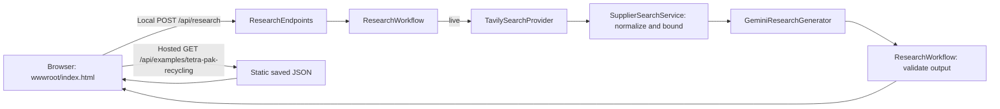

# Architecture and interview handover

## Product and scope

Supplier Research Assistant helps a sustainability analyst review public supplier sustainability reporting and prepare follow-up questions. The MVP searches, presents up to five bounded excerpts, and can generate attributed findings. It does not rate suppliers, verify certifications, establish compliance, or prove performance; missing evidence does not prove absence.

Current demo state: hosted live calls are off. The hosted page displays the saved Tetra Pak capture from 2026-10-18: five real provider sources, zero validated AI findings, and no follow-up questions. Earlier live findings were reported during development, but were not retained. Local live search remains available when configured.

## Request flow

`Program.cs` selects local versus hosted routes and provider registrations. `ResearchEndpoints.cs` validates requests, applies deadlines and handles safe errors. `Search.cs` defines the search contract, fixture and Tavily providers, and source normalization. `Generation.cs` defines response contracts, the Gemini adapter, workflow and evidence validator. `ResearchControls.cs` contains server-defined presets and the process-local request gate. The hosted saved result is `wwwroot/examples/tetra-pak-recycling.json`; the simple safe renderer is `wwwroot/index.html`.

## Contracts, settings, and secrets

- Local `POST /api/research` accepts `{ "supplier": string, "question": string }`; lengths are 2-120 and 10-500. It is mapped only outside hosted mode when `Search:AllowArbitraryQueries=true`.
- Hosted `GET /api/examples/{presetId}` serves only allowlisted saved JSON. `GET /api/demo/presets` reports mode and flags. `POST /api/demo/{presetId}` resolves inputs on the server and rejects body/query overrides; with live off it returns 503. Other hosted `/api/*` routes return 404. `GET /health` does not call providers.
- Responses contain mode/status, findings with `{sourceId, excerptSpan}`, follow-up questions, sources (`id/title/url/excerpt/provenance`), warnings, and optional model/usage. The saved route wraps the captured research with mode/date/notice. Errors use safe Problem Details with a request ID; successful research responses do not currently include one.
- `Search:Mode` is `Fixture` or `Tavily`; `Generation:Model` defaults to `gemini-3.1-flash-lite`. `Hosting:Mode` and `Hosting:LiveEnabled` control hosted behavior. Production container defaults are Hosted, Fixture, and live disabled. Development enables local arbitrary queries in `launchSettings.json`.
- `TAVILY_API_KEY` and `GEMINI_API_KEY` stay server-side in User Secrets, environment configuration, or Azure secrets. Tavily uses bearer auth; Gemini uses `x-goog-api-key`. Keys are not in source, image, browser code, or logs. The M0 probe's User Secrets are separate.

## Design decisions and trade-offs

**Documented in the original MVP plan:** one ASP.NET Core app, native `HttpClient`/`System.Text.Json`, plain HTML/JavaScript, Tavily, Gemini structured generation, five sources, no database, Docker, one build/test workflow, and manual Azure deployment. Database, vector search, React, staging, auto promotion/deployment, and semantic grading were deferred. Stated learning goals were C#, API integration, failure handling, tests, Docker, and Azure. The plan does not give detailed vendor/framework comparisons.

**Retrospective trade-offs:** direct HTTP exposes provider requests and limits but makes the app own serialization/error mapping. Static HTML ships simply but offers less interaction and browser-test coverage. Exact quote matching rejects invented spans but neither proves the claim nor tolerates harmless normalization. A saved file keeps the demo available with live calls off, but provides no history. Persistence/vector retrieval can wait until there is a demonstrated need.

## Failure behavior and boundaries

- Tavily uses basic search, max eight raw results, and disables answer/raw-content/image features and automatic parameter changes. `SupplierSearchService` filters invalid/duplicate HTTP(S) URLs, assigns `S1...` IDs, retains five sources, and caps excerpts at 2,000 characters each/10,000 total. Search failures produce safe Problem Details: auth/quota 503, timeout 504, other upstream/transport 502.
- No sources returns `insufficient_evidence`, without generation. Generation HTTP, transport, configuration, invalid-response, or timeout failures return `sources_only` with a warning. Caller cancellation propagates. Rejected output is not retried.
- Generation requires the expected JSON shape; limits are five findings (600 characters each), 300-character evidence spans, and three follow-ups (200 characters each). IDs match ordinally and each span must occur verbatim in that source excerpt. This validates citation traceability, not truth.
- The endpoint deadline is 30 seconds; search and generation clients have 8- and 15-second timeouts; browser requests use 35 seconds. Live requests admit one in flight, three per rolling minute, and twenty per process lifetime. These in-memory limits reset on restart and are not global spending caps.
- Browser output uses text nodes and permits only HTTP(S) source links. Provider excerpts remain distinct from original-page verification.

## Verification and delivery evidence

The 25 deterministic xUnit tests use mocked providers/HTTP. They cover five fixed behaviors (supported, multi-claim, missing-context, abstention, conflicting sources), provider errors, cancellation, validation/fallback, route restrictions, live-off, and request limits. They do not establish real-world claim accuracy.

Live checks were separate: Tavily returned HTTP 200 and source fields; Gemini returned HTTP 200 with model version `gemini-3.1-flash-lite` and usage. A later captured Tetra Pak search retained five provider excerpts but generation failed evidence validation, so the public saved capture has zero findings. Earlier successful live findings were reported but are not available as a retained artifact.

Commit `0e3457e` passed GitHub Actions tests and image build/publish, then was manually deployed to the existing Azure app using its private GHCR commit tag. The active revision was healthy with 100% traffic, target port 8080, replicas 0/1. Deployed `/health`, page, and saved-result route returned expected content: five provider excerpts, zero findings. Hosted live stayed off.

`Dockerfile` builds and publishes a non-root .NET 10 image listening on 8080. `.dockerignore` excludes tests, secrets/local configuration, IDE/build output, scripts, and documents. `.github/workflows/build-test.yml` runs tests and builds on pull requests; on pushes to `main`, it authenticates with the workflow token and publishes a commit-SHA tag to private GHCR. It does not deploy. Azure deployment is a separate manual `az containerapp update` using the published tag.

During deployment, the app ingress targeted port 80 while the image listened on 8080 (`ASPNETCORE_HTTP_PORTS=8080`). Updating the existing ingress target port to 8080 resolved the mismatch; no new resources or image rebuild were needed for that port correction.

## Interview walkthroughs

**90 seconds:** State the analyst's problem and boundary: this summarizes public reporting, not supplier certification. Trace local validation -> Tavily -> bounded sources -> Gemini -> exact evidence validation. Contrast hosted saved results with local live mode. Close by noting a matching quote is not proof of truth.

**Five-minute demo:** (1) Open hosted page; identify the dated saved capture, five sources, and zero findings. (2) Show `/health` and saved JSON. (3) Run local Development with Tavily configured through User Secrets; inspect sources and returned status/evidence. (4) Explain fixture and hosted live-off modes. (5) Show tests and the Docker/CI path. Do not expose keys or imply source excerpts prove claims.

## Interview questions and answer cues

1. **Why separate provider interfaces?** They isolate HTTP adapters and enable deterministic test doubles.
2. **How does cancellation work?** A linked request deadline reaches provider calls; caller cancellation propagates, internal deadlines are mapped by stage.
3. **What does evidence validation prove?** Source membership and literal span presence, not relevance or truth.
4. **Why return sources after generation failure?** Preserve search utility without inventing findings or repeating a billable call.
5. **Why no database/vector store?** The MVP has one saved capture and no history/retrieval requirement; persistence was deferred.
6. **What do request limits protect?** Per-process concurrent, rate, and lifetime admissions, not global quota/spend.
7. **How are secrets kept out of the image?** Server config supplies them at runtime; auth headers are added in adapters; local secret files are excluded from Docker context.
8. **How does deployment work?** CI tests and publishes a private commit tag; a person updates Azure. CI does not deploy.

## Portfolio and next steps

**Portfolio description:** A C# supplier-research prototype that searches public reporting, bounds and attributes provider excerpts, validates structured model citations, and serves a no-live-call saved demonstration.

- Built a .NET 10 research API integrating Tavily search and Gemini structured output, with bounded sources and exact source-ID/excerpt validation.
- Added deterministic provider/workflow tests and a GitHub Actions image pipeline publishing commit-tagged containers to private GHCR; Azure promotion remains manual.

**Limitations:** no original-page verification, authentication, tenant isolation, persistent history, durable/global rate or spend limits, or hosted live research. Exact quote matching does not verify claims. Provider free quotas and Azure usage do not guarantee zero out-of-pocket cost.

**Most useful future improvements:**

1. Build a human-reviewed evaluation set for source relevance and claim support; exact-span matching alone is insufficient.
2. Before enabling hosted live calls, add user authentication and durable distributed rate/quota controls, then verify provider and cloud spending protections.
3. Add persistence and reviewable research history only if analysts need repeat sessions, retention, or audit trails.
